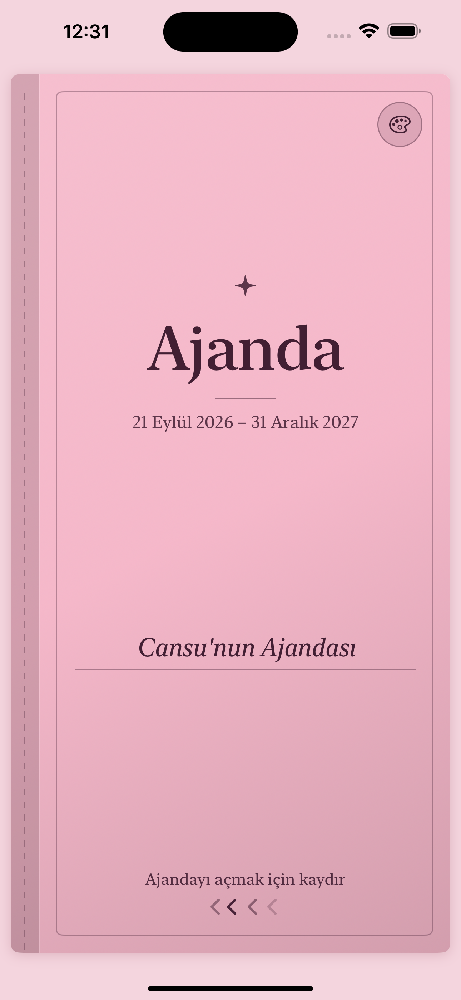
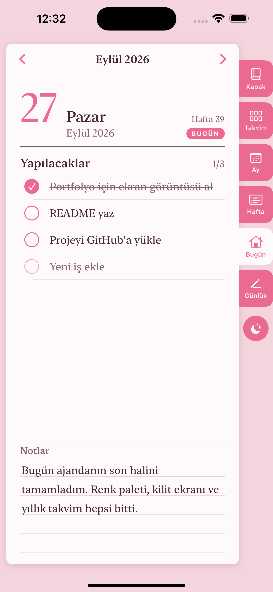
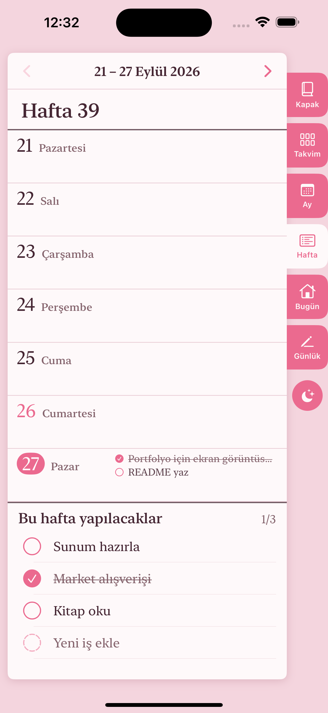
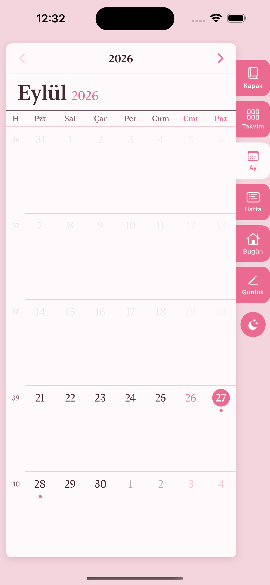
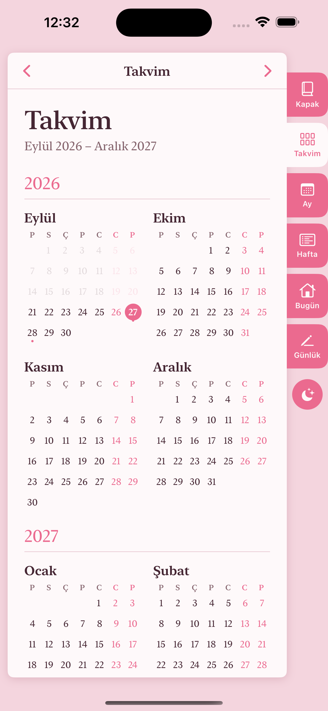
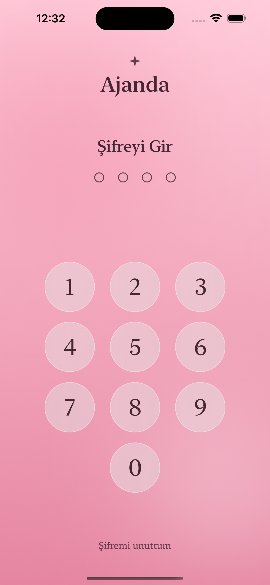
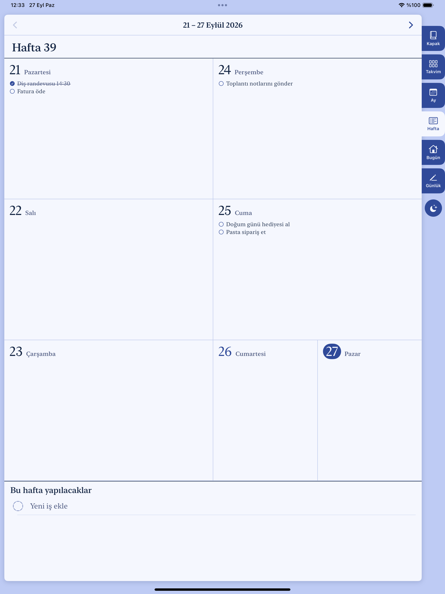

# Ajanda

Kağıda basılı klasik bir ajandanın hissini veren, iOS ve iPadOS için SwiftUI ile yazılmış dijital bir ajanda. 21 Eylül 2026 – 31 Aralık 2027 arasını kapsar; kapağı kaydırarak açarsınız, yıllık takvimden güne, haftaya, aya geçersiniz, yapılacaklarınızı işaretlersiniz, günlük tutarsınız.

Harici hiçbir bağımlılığı yok, hiçbir sunucuya veri göndermiyor — notlarınız yalnızca kendi cihazınızda duruyor.

## Ekran görüntüleri

| Kapak | Gün | Hafta |
|---|---|---|
|  |  |  |

| Ay | Yıllık takvim | Kilit ekranı |
|---|---|---|
|  |  |  |

**iPad'de haftalık görünüm** — geniş ekranda gerçek bir ajanda gibi iki sayfa yan yana açılır:



## Özellikler

- **Kapak ve renk paleti** — 12 hazır renkten biri seçilir; seçilen renk açık/koyu temanın tamamını (zemin, kâğıt, yazı, vurgu rengi) matematiksel olarak belirler ve ana ekran ikonuyla eşleşir.
- **Kaydırarak açılan kapak** — kitap sayfası gibi 3D dönerek açılır, yarım bırakılırsa geri kapanır.
- **Yıllık takvim** — ajandanın kapsadığı 16 ayın küçük takvimleri tek sayfada; not/yapılacak olan günlerin altında nokta çıkar.
- **Gün, hafta, ay görünümleri** — dar ekranda (iPhone) liste, geniş ekranda (iPad) iki sayfalık "açık ajanda" görünümü.
- **Yapılacaklar listesi** — her günde ve her haftanın sonunda, yuvarlağa dokunarak işaretlenen bir liste.
- **Günlük / sabah sayfaları** — ajandanın sonunda 30 boş, çizgili, yazılabilir tarihli sayfa.
- **Yerel kilit ekranı** — iPhone'un kendi şifre ekranına benzer 4 haneli şifre + Face ID/Touch ID. Şifre düz metin olarak hiçbir yerde tutulmaz; tuzlanmış SHA-256 özeti olarak yalnızca cihazın Anahtar Zinciri'nde durur. Uygulamadan her çıkışta yeniden kilitlenir.
- **Açık / koyu tema**, tamamen Türkçe arayüz, Pazartesi başlayan hafta.

## Nasıl geliştirildi

Bu uygulamanın tamamı, [Claude Code](https://claude.com/claude-code) ile doğal dilde konuşarak, adım adım birlikte geliştirildi: önce temel ajanda (aylar, günler, haftalar), sonra yapılacaklar listesi, renkli tema sistemi, kayan kapak, yıllık takvim ve yerel kilit ekranı. Her özellik simülatörde ekran görüntüsüyle doğrulanarak ilerlendi.

Bu süreçte karşılaşılan gerçek teknik sorunlar — Anahtar Zinciri'nin imzasız derlemede sessizce başarısız olması, iPad'de tuş takımının ekranın dibine yapışması, çizgili kağıdın çizgilerinin hiç görünmemesi gibi — nedenleriyle ve çözümleriyle birlikte **[docs/SORUNLAR_VE_COZUMLER.md](docs/SORUNLAR_VE_COZUMLER.md)** dosyasında anlatılıyor. Projeye Claude Code ile devam edecek biri için de **[CLAUDE.md](CLAUDE.md)** dosyası, mimarinin nasıl bir araya geldiğini özetliyor.

## Teknik

- %100 SwiftUI, harici paket bağımlılığı yok (SPM/CocoaPods yok).
- Çizgili not alanı, öngörülebilir satır yüksekliği için `UIViewRepresentable` ile sarılmış özel bir `UITextView`.
- Tema, tek bir kapak renginden HSB/RGB hesabıyla (kontrast hedefine göre otomatik parlaklık ayarı) üretiliyor.
- Notlar ve yapılacaklar `UserDefaults`'ta, şifre Anahtar Zinciri'nde; sunucu ya da hesap yok.
- Bundle id: `com.cansukoc.Dijital-Ajanda` · Dağıtım hedefi: iOS 17.5 · Swift 5.

## Çalıştırma

```bash
git clone https://github.com/<kullanıcı-adınız>/dijital-ajanda.git
cd dijital-ajanda
open "Dijital Ajanda.xcodeproj"
```

Xcode'da üstteki cihaz seçiciden bir simülatör ya da kendi iPhone/iPad'inizi seçip ▶ (Run) tuşuna basmanız yeterli. Kendi cihazınızda çalıştırmak isterseniz proje ayarlarında **Signing & Capabilities** sekmesinden **Team**'i kendi Apple ID'nizle değiştirin (imzalama zaten `Automatic`).

Komut satırından hızlı derleme doğrulaması ve mimariyle ilgili ayrıntılar için [CLAUDE.md](CLAUDE.md)'ye bakabilirsiniz.

## Lisans

[MIT](LICENSE)
